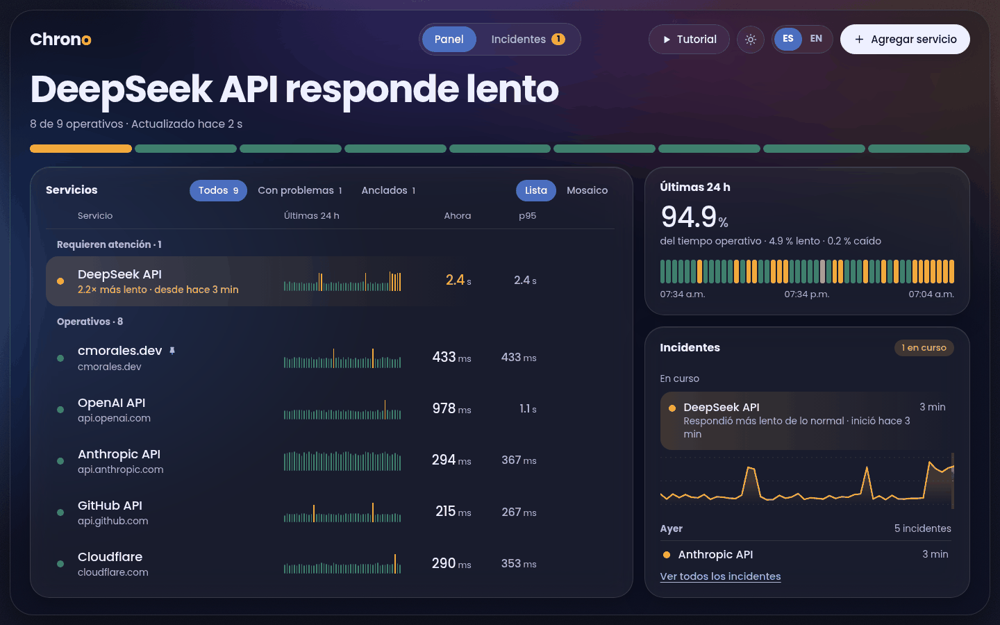
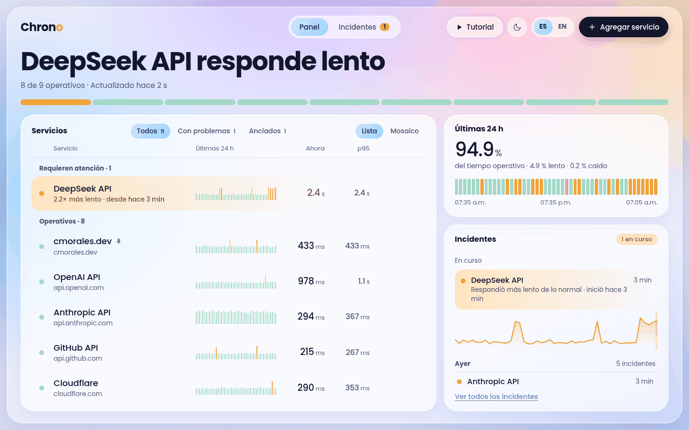
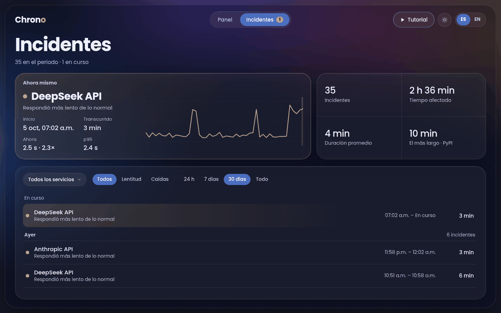
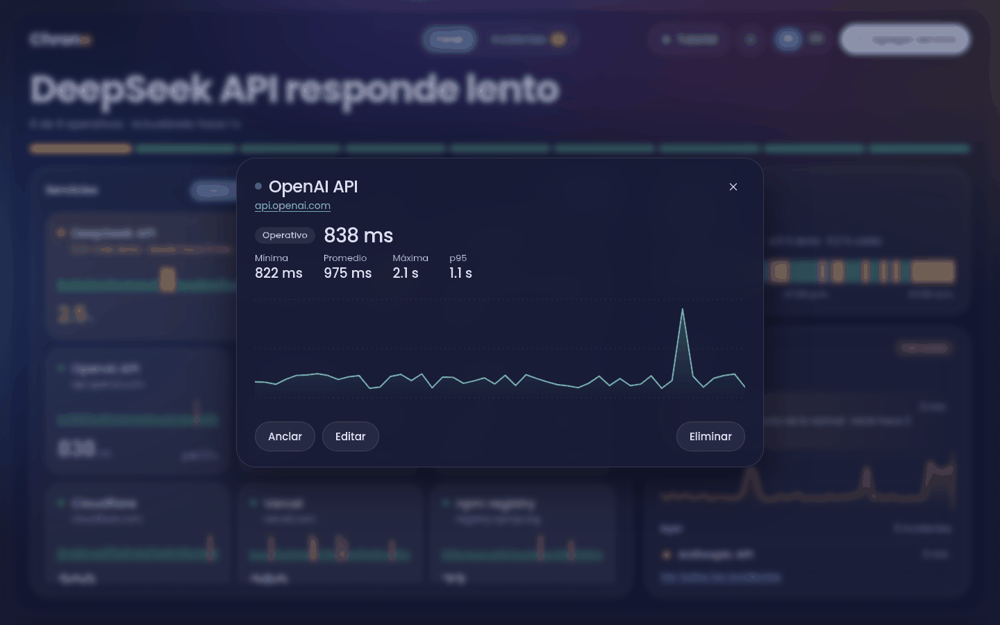
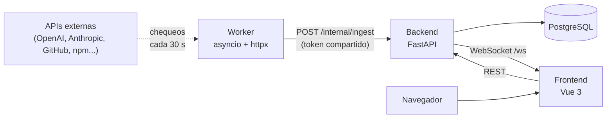
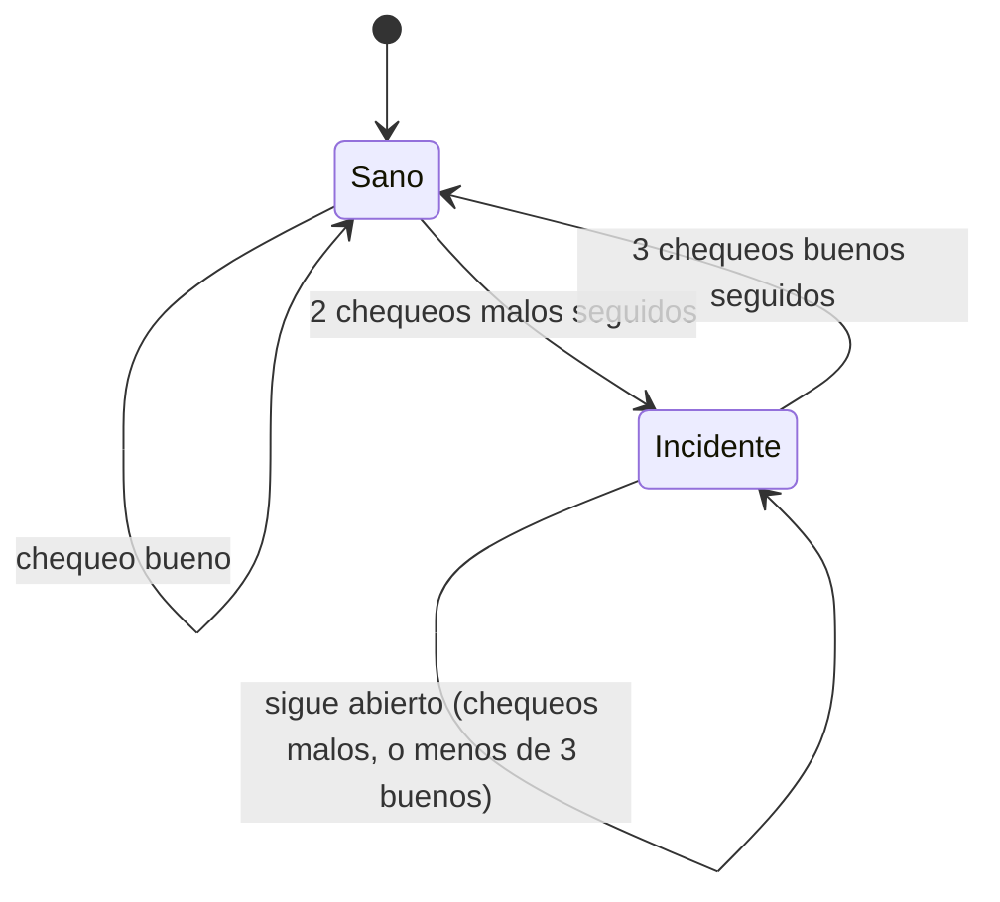

# Chrono

[English](README.md) | **Español**

[](https://github.com/carlosmorales-dev-mx/Chrono/actions/workflows/ci.yml)

Monitor de estado en tiempo real para APIs y servicios públicos. Chrono revisa una
lista configurable de direcciones cada cierto tiempo, guarda el historial, abre y
cierra incidentes por su cuenta y empuja las actualizaciones en vivo a todos los
navegadores conectados por WebSocket: no hace falta recargar para ver caer un
servicio.



| Tema claro | Incidentes | Detalle en mosaico |
| --- | --- | --- |
|  |  |  |

## Pruébalo en 30 segundos

La interfaz tiene un **modo demo** con datos simulados, así que puedes verla sin
backend, sin base de datos y sin worker:

```bash
cd frontend
pnpm install
pnpm dev
```

Abre `http://localhost:5173/?demo`. Agrega `=caida` para ver una caída en curso, o
`=ok` para ver todo operativo. El botón **Tutorial** de la barra superior recorre
toda la interfaz con un cursor animado.

## Visión general

Chrono separa el monitoreo en tres procesos independientes que solo se hablan por
HTTP y WebSocket, nunca compartiendo una conexión a la base de datos:

- Un **worker** revisa todos los servicios monitoreados en paralelo cada cierto
  intervalo y reporta los resultados al backend. No tiene credenciales de base de
  datos, solo la URL del backend y un token compartido.
- El **backend** es el único proceso que habla con PostgreSQL. Valida y guarda los
  resultados, detecta incidentes, sirve la API y transmite las actualizaciones en
  vivo a cada navegador conectado.
- El **frontend** dibuja el panel y recibe las actualizaciones por WebSocket, así
  que un servicio que cae aparece en pantalla en segundos, sin consultas repetidas.

## Características

- Panel en vivo: un titular de una frase, una franja con un segmento por servicio y
  una lista agrupada en «requieren atención» y «operativos». Lo sano se queda
  callado; lo roto destaca.
- Vistas de lista y de mosaico. En la lista una fila se despliega en su lugar; en el
  mosaico el detalle se abre en un cuadro centrado para que la cuadrícula nunca se
  mueva.
- Agregar, editar, anclar y quitar servicios monitoreados desde la interfaz.
- **Incidentes que se abren y se cierran solos**, con histéresis: hacen falta dos
  chequeos malos seguidos para abrir uno y tres buenos para cerrarlo, así que un
  servicio que oscila alrededor de su umbral de latencia no genera decenas de
  incidentes de 30 segundos.
- Pantalla de incidentes con el que está en curso destacado y marcado sobre su
  curva de latencia, filtros por servicio, tipo y periodo, y detalle de cada uno.
- Historial de latencia de 24 horas agrupado por tiempo, **que incluye las caídas**,
  y percentiles p50 / p95 / p99.
- Insignias SVG de estado para incrustar, una por servicio.
- Tutorial interactivo, temas claro y oscuro, español e inglés.
- Accesibilidad: contraste AA de WCAG medido en ambos temas, foco visible y soporte
  de `prefers-reduced-motion` y `prefers-contrast`.
- Modo de solo lectura, para que una demo pública muestre datos reales sin dejar que
  nadie los edite.

## Arquitectura



Cómo se abre y se cierra un incidente:



El worker nunca se conecta a PostgreSQL. Solo conoce la URL del backend y le reporta
los resultados con un POST HTTP; el backend es el único dueño del esquema y el único
proceso con credenciales de base de datos. Eso mantiene al worker desechable y fácil
de escalar o reemplazar.

## Tecnologías

| Capa | Tecnología |
| --- | --- |
| Frontend | Vue 3, Vite, Pinia, vue-router, vue-i18n |
| Backend | FastAPI, SQLAlchemy, Alembic, WebSockets |
| Worker | Python asyncio, httpx |
| Base de datos | PostgreSQL 16 |
| Contenedores | Podman (Compose), nginx |
| CI | GitHub Actions, Dependabot |

## Primeros pasos

### Requisitos

- Python 3.12 o más reciente
- Node.js 22 o más reciente y [pnpm](https://pnpm.io)
- [Podman](https://podman.io) y `podman-compose`

### Desarrollo local

```bash
git clone https://github.com/carlosmorales-dev-mx/Chrono.git chrono
cd chrono
cp backend/.env.example backend/.env
cp worker/.env.example worker/.env
make install     # entornos virtuales y node_modules
make start       # levanta PostgreSQL, crea el esquema y carga los servicios iniciales
make dev         # PostgreSQL + backend + worker + frontend juntos
```

Abre `http://localhost:5173`. Pon el mismo `INGEST_TOKEN` en `backend/.env` y en
`worker/.env`. El worker revisa cada 30 segundos, así que el panel se llena poco a
poco. Detén los tres procesos con `Ctrl+C`; PostgreSQL sigue corriendo hasta que
uses `make down`. Cada pieza también corre por separado:

```bash
make db          # solo PostgreSQL
make backend     # FastAPI con recarga automática
make worker      # el worker de chequeos
make frontend    # el servidor de desarrollo de Vite
```

### Todo en contenedores

```bash
make stack       # construye las imágenes y levanta PostgreSQL, backend, worker y frontend
```

Abre `http://localhost:8080`. nginx sirve la interfaz y reenvía al backend solo la
API pública, así que el navegador habla con un único origen. El endpoint de ingesta
**no** es alcanzable desde fuera de la red de contenedores. Sigue los logs con
`make stack-logs` y detén todo con `make stack-down`; los datos quedan en el volumen
`chrono_pgdata`. La base del stack arranca **vacía**: agrega servicios desde la interfaz,
o carga los iniciales con `podman exec chrono_backend python seed_servicios.py`. El stack lee sus secretos de `backend/.env` y `worker/.env`, y usa su
propio volumen y sus propios nombres, así que puede correr junto a `make dev`.

## Configuración

Toda variable tiene un valor por defecto razonable, salvo `DATABASE_URL`. Los
archivos `.env.example` las documentan en su lugar.

### Backend (`backend/.env`)

| Variable | Por defecto | Qué hace |
| --- | --- | --- |
| `DATABASE_URL` | ninguno (obligatoria) | Cadena de conexión a PostgreSQL. |
| `INGEST_TOKEN` | vacío | Secreto compartido que el worker manda en `X-Ingest-Token`. Si está vacío, cualquiera que alcance el backend puede inyectar chequeos. |
| `CHRONO_SOLO_LECTURA` | `false` | Modo de solo lectura: bloquea crear, editar, anclar y borrar servicios. |
| `CORS_ORIGINS` | vacío | Orígenes extra permitidos, separados por comas. `localhost` y `127.0.0.1` siempre se permiten. |
| `PERMITIR_OBJETIVOS_PRIVADOS` | `false` | Permite servicios que apunten a direcciones internas (`localhost`, `192.168.x.x`). Las direcciones de metadatos de la nube nunca se permiten. |
| `INCIDENTE_ABRIR_TRAS` | `2` | Chequeos malos seguidos que hacen falta para abrir un incidente. |
| `INCIDENTE_CERRAR_TRAS` | `3` | Chequeos buenos seguidos que hacen falta para cerrarlo. |
| `RETENCION_DIAS` | `30` | Días de chequeos crudos que se conservan (`0` = conservar siempre). Los incidentes siempre se conservan. |
| `LOG_LEVEL` | `INFO` | Nivel de detalle de los logs. |

### Worker (`worker/.env`)

| Variable | Por defecto | Qué hace |
| --- | --- | --- |
| `BACKEND_URL` | `http://127.0.0.1:8001` | Dónde está el backend. |
| `INGEST_TOKEN` | vacío | Debe ser igual al del backend. |
| `CHECK_INTERVAL` | `30` | Segundos entre rondas (mínimo 5). |
| `UMBRAL_DEGRADADO_MS` | `1200` | Una respuesta correcta pero más lenta que esto cuenta como «degradado». |
| `TIMEOUT_S` | `5` | Segundos de espera por servicio antes de darlo por caído. |

El worker también lee `PERMITIR_OBJETIVOS_PRIVADOS` y `LOG_LEVEL`, con el mismo significado.

### Frontend y contenedores

| Variable | Por defecto | Qué hace |
| --- | --- | --- |
| `VITE_API_URL` | `http://127.0.0.1:8001` | Dirección del backend al compilar. Vacía significa «el mismo origen» (la imagen de contenedor). |
| `VITE_WS_URL` | derivada | Dirección del WebSocket, si es distinta de la de la API. |
| `VITE_DEMO` | sin definir | `true` fuerza el modo demo (datos simulados). |
| `POSTGRES_USER` | `pulse` | Usuario de la base de datos en el stack de contenedores. |
| `POSTGRES_PASSWORD` | `pulse` | Contraseña de la base de datos en el stack de contenedores. Cámbiala fuera de tu propia máquina. |
| `POSTGRES_DB` | `pulse` | Nombre de la base de datos en el stack de contenedores. |
| `FRONTEND_PORT` | `8080` | Puerto donde el stack sirve la interfaz (ligado a `127.0.0.1`). |

## API

| Método | Ruta | Descripción |
| --- | --- | --- |
| `GET` | `/health` | `200` si el servidor y la base responden, `503` si no. |
| `GET` | `/` | Mensaje del servidor. |
| `GET` | `/servicios` | Servicios monitoreados. |
| `POST` | `/servicios` | Agrega un servicio (la URL se valida). |
| `PUT` | `/servicios/{id}` | Cambia el nombre o la URL. |
| `PATCH` | `/servicios/{id}/anclar` | Ancla o desancla. |
| `DELETE` | `/servicios/{id}` | Quita un servicio y su historial. |
| `GET` | `/chequeos/recientes` | Los 50 chequeos más recientes. |
| `GET` | `/chequeos/estado-actual` | Último estado de cada servicio. |
| `GET` | `/chequeos/{id}/historial` | Historial agrupado por tiempo, caídas incluidas (`horas`, `puntos`). |
| `GET` | `/chequeos/{id}/percentiles` | p50 / p95 / p99 de las últimas 24 horas. |
| `GET` | `/badge/{id}.svg` | Insignia SVG de estado. |
| `GET` | `/incidentes` | Incidentes (`dias`, `limite`, `servicio_id`, `estado`, `activos`); cabecera `X-Total-Count`. |
| `WS` | `/ws` | Actualizaciones de chequeos en vivo. |

El worker también hace POST a `/internal/ingest`, que exige el token compartido y no
se reenvía en el stack de contenedores. FastAPI sirve la documentación interactiva en
`/docs`.

## Pruebas y calidad

```bash
make test             # pruebas unitarias de backend y worker (sin base de datos)
make smoke            # prueba de humo en vivo contra un backend encendido (make dev)
make migrate          # aplica las migraciones de la base de datos (Alembic)
make revision m="agrega una columna"    # migración nueva desde los cambios del modelo
make unused           # informe de archivos sin uso, carpetas vacías y cachés
make check-containers # revisa Containerfiles, compose, nginx, CI y este README
```

`make smoke` crea un servicio temporal, ejercita la seguridad, la histéresis de
incidentes, el historial y las insignias contra tu base de datos real, y lo borra.
El CI (`.github/workflows/ci.yml`) corre las pruebas unitarias, aplica las
migraciones a un PostgreSQL vacío, corre la misma prueba de humo, compila el
frontend, construye las tres imágenes de contenedor y comprueba que este README
sigue coincidiendo con el código (`tools/verificar_docs.py`).

## Solución de problemas

| Síntoma | Causa probable | Solución |
| --- | --- | --- |
| `uvicorn: command not found` tras `make backend` | El venv del backend no tiene dependencias o nunca se creó | `make install-backend` |
| `externally-managed-environment` en `pip install` | La terminal no está dentro del venv | Usa el binario del venv: `backend/venv/bin/pip install -r backend/requirements.txt` |
| `ModuleNotFoundError` justo después de copiar el proyecto de otra máquina | Los entornos virtuales guardan rutas absolutas y no son portables | `rm -rf backend/venv worker/venv` y luego `make install` |
| Errores del frontend tras copiar el proyecto | `node_modules` trae binarios propios de cada máquina | `rm -rf frontend/node_modules` y luego `make install-frontend` |
| `Makefile:N: *** missing separator. Stop.` | Una línea de receta está indentada con espacios en vez de tabulador | Revisa con `cat -A Makefile`; los tabuladores reales salen como `^I` |
| `'case' builtin usado fuera de un bloque 'switch'` al activar un venv | La terminal es `fish` y `venv/bin/activate` es un script de `bash` | `source venv/bin/activate.fish`, o usa `make`, que fuerza `bash` |
| `short-name "postgres:16-alpine" did not resolve to an alias` | Podman necesita el nombre completo de la imagen | Usa `docker.io/library/postgres:16-alpine`, como hace `podman-compose.yml` |
| `relation "servicios" does not exist` | Nunca se creó el esquema | `make migrate` (o `make start`) |
| El worker registra `el backend rechazó el token` | `INGEST_TOKEN` es distinto en `backend/.env` y `worker/.env` | Pon el mismo valor en los dos y reinicia |
| `make smoke` dice que ningún backend responde | El backend no está corriendo | Corre `make dev` en una terminal y `make smoke` en otra |
| Agregar un servicio falla con «dirección no permitida» | La URL apunta a una dirección interna | Usa una URL pública, o pon `PERMITIR_OBJETIVOS_PRIVADOS=true` |
| Aviso «Conexión perdida, reconectando...» | El backend está caído, o el frontend corre en un origen que no permite | Revisa `make dev`; para un origen propio define `CORS_ORIGINS` |
| `make stack` falla con un error de `env_file` | `backend/.env` o `worker/.env` no existe | `cp backend/.env.example backend/.env` (igual con `worker`) |

## Estructura del proyecto

```
.
├── backend
│   ├── api/routes.py           rutas HTTP
│   ├── main.py                 app, CORS, /health, WebSocket, tareas de arranque
│   ├── config.py               configuración desde variables de entorno
│   ├── dominio.py              lógica pura: validación, incidentes, historial, percentiles, insignia
│   ├── incident_detector.py    aplica las reglas de incidentes a la base de datos
│   ├── db_models.py            modelos ORM
│   ├── models_schemas.py       esquemas de las peticiones
│   ├── websocket_manager.py    difusión a los navegadores conectados
│   ├── migrar.py               ejecuta Alembic (con un modo simple de respaldo)
│   ├── migrations/             entorno y versiones de Alembic
│   ├── retencion.py            borra los chequeos crudos viejos
│   ├── espera_db.py            espera a PostgreSQL (arranque del contenedor)
│   ├── seed_servicios.py       carga los servicios iniciales
│   ├── Containerfile
│   └── tests/                  pruebas unitarias
├── worker
│   ├── check_servicios.py      chequeos de salud en paralelo
│   ├── logica.py               lógica pura: clasificación, protección contra direcciones internas
│   ├── Containerfile
│   └── tests/
├── frontend
│   ├── src/                    vistas, componentes, stores, tutorial, idiomas
│   ├── nginx.conf              sirve la app y reenvía la API
│   └── Containerfile
├── tools
│   ├── mantenimiento.py        archivos sin uso, carpetas vacías, cachés
│   ├── humo_backend.py         prueba de humo en vivo
│   ├── verificar_contenedores.py   revisión estática de contenedores y CI
│   └── verificar_docs.py       compara este README con el código
├── docs/img                    capturas de pantalla
├── .github                     workflow de CI y Dependabot
├── podman-compose.yml          PostgreSQL para desarrollo local
├── podman-compose.stack.yml    todo el stack en contenedores
└── Makefile
```

## Decisiones de diseño

- **El worker nunca toca la base de datos.** Solo conoce la URL del backend y un
  token, así que las credenciales viven en un solo lugar y el worker es trivial de
  reiniciar o reemplazar.
- **Los incidentes usan histéresis.** Abrir con el primer chequeo malo y cerrar con
  el primero bueno convierte a cualquier servicio que oscile alrededor de su umbral
  en un chorro de incidentes diminutos. Exigir varios seguidos lo resuelve, y la
  propia base de datos garantiza un solo incidente abierto por servicio (un índice
  único parcial). El inicio de un incidente es el primer chequeo malo de la racha,
  no el que la confirmó.
- **El historial se agrupa por tiempo y conserva las caídas.** Promediar bloques fijos
  de filas puede borrar una caída corta, y descartar los chequeos sin latencia la
  esconde. Cada tramo reporta su peor estado y la latencia media de los chequeos que
  sí respondieron. El ancho del tramo se adapta a los datos, así que un servicio
  recién agregado muestra enseguida sus puntos reales en vez de una gráfica vacía.
- **La lógica de decisión es Python puro.** `backend/dominio.py` y `worker/logica.py`
  no dependen de ningún framework ni de la red, así que las reglas importantes se
  prueban sin base de datos.
- **Las direcciones internas se bloquean dos veces.** El backend valida las URLs al
  crear un servicio, y el worker vuelve a comprobar con la IP *resuelta* justo antes
  de conectarse, porque un nombre público puede apuntar a una dirección interna. Las
  direcciones de metadatos de la nube nunca se permiten.
- **El endpoint de ingesta exige un token y no se reenvía.** En el stack de
  contenedores nginx reenvía solo la API pública.
- **Los fallos de difusión se limpian solos.** El gestor de WebSocket envía a todos
  los navegadores a la vez, con tiempo límite, y descarta los que dejaron de
  responder, así que una pestaña lenta no frena a las demás.
- **El trabajo bloqueante de base de datos no ocupa el bucle de eventos.** El
  manejador del ingest ejecuta el código síncrono de SQLAlchemy en un hilo aparte y
  después transmite.
- **La interfaz evita repintar de más.** Solo dos componentes diminutos leen el reloj
  de un segundo; todo lo demás usa uno de 30 segundos. El tutorial y los datos de la
  demo se descargan solo cuando se usan, y los temporizadores se pausan con la
  pestaña oculta.
- **CORS usa una expresión regular para localhost.** Vite cambia de puerto cuando el
  5173 está ocupado, y una lista fija de orígenes se rompería en silencio.

## Limitaciones conocidas

- No hay cuentas de usuario. Cualquiera que alcance el backend puede agregar, editar
  o borrar servicios, a menos que actives el modo de solo lectura
  (`CHRONO_SOLO_LECTURA`). Ponlo detrás de tu propia autenticación antes de exponerlo
  públicamente.
- Un solo worker. Correr varios duplicaría cada chequeo.
- Todavía no hay notificaciones (correo, Slack, webhooks): los incidentes solo se ven
  en la interfaz.
- Los servicios se revisan con un GET simple y un umbral de latencia fijo compartido
  por todos (`UMBRAL_DEGRADADO_MS`), no uno por servicio.

## Autor

Carlos Morales -- [cmorales.dev](https://cmorales.dev)
