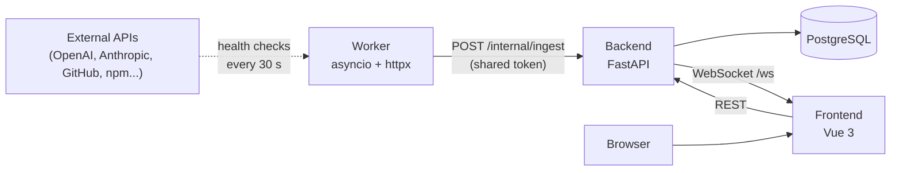
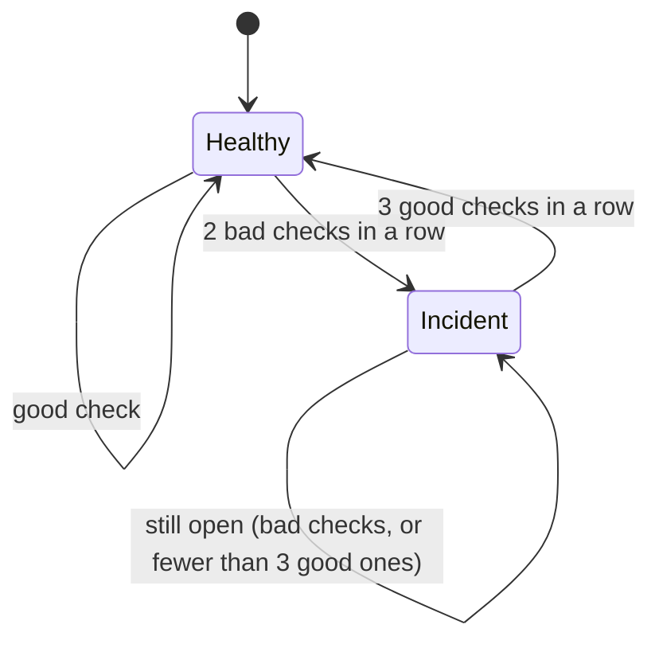

# Chrono

**English** | [Español](README.es.md)

[](https://github.com/carlosmorales-dev-mx/Chrono/actions/workflows/ci.yml)

Real-time status monitor for public APIs and services. Chrono checks a
configurable list of endpoints on an interval, stores the history, opens and
closes incidents on its own, and pushes live updates to every connected browser
over a WebSocket -- no refresh needed to see a service go down.


| Light theme | Incidents | Tile detail |
| --- | --- | --- |
|  |  |  |

## Try it in 30 seconds

The interface has a **demo mode** with simulated data, so you can see it without a
backend, a database or a worker:

```bash
cd frontend
pnpm install
pnpm dev
```

Then open `http://localhost:5173/?demo`. Add `=caida` for an outage in progress,
or `=ok` for everything operational. The **Tutorial** button in the top bar walks
through the whole interface with an animated cursor.

## Overview

Chrono splits status monitoring into three independent processes that only talk
to each other over HTTP and WebSocket, never by sharing a database connection:

- A **worker** checks every monitored service in parallel on a fixed interval and
  reports the results to the backend. It holds no database credentials at all,
  only the backend's URL and a shared token.
- The **backend** is the only process that talks to PostgreSQL. It validates and
  stores the results, detects incidents, serves the API and broadcasts live
  updates to every connected browser.
- The **frontend** renders the dashboard and receives updates over a WebSocket,
  so a service going down appears on screen within seconds, without polling.

## Features

- Live dashboard: a one-sentence headline, a strip with one segment per service,
  and a list grouped into "need attention" and "operational". The healthy stay
  quiet; the broken stand out.
- List and tile views. In list view a row expands in place; in tile view the
  detail opens in a centered dialog so the grid never moves.
- Add, edit, pin and remove monitored services from the interface.
- **Incidents opened and closed automatically**, with hysteresis: it takes two bad
  checks in a row to open one and three good ones to close it, so a service that
  hovers around its latency threshold does not produce dozens of 30-second
  incidents.
- Incidents screen with the one in progress featured and highlighted on its latency
  curve, filters by service, type and period, and per-incident detail.
- 24-hour latency history grouped by time, **including outages**, plus p50 / p95 /
  p99 percentiles.
- Embeddable SVG status badges, one per service.
- Interactive tutorial, light and dark themes, Spanish and English.
- Accessibility: WCAG AA contrast measured in both themes, visible focus,
  `prefers-reduced-motion` and `prefers-contrast` support.
- Read-only mode, so a public demo can show real data without letting anyone edit
  it.

## Architecture



How an incident is opened and closed:



The worker never connects to PostgreSQL. It only knows the backend's URL and
reports results over a plain HTTP POST; the backend is the single owner of the
schema and the only process with database credentials. This keeps the worker
disposable and easy to scale or replace.

## Tech stack

| Layer | Technology |
| --- | --- |
| Frontend | Vue 3, Vite, Pinia, vue-router, vue-i18n |
| Backend | FastAPI, SQLAlchemy, Alembic, WebSockets |
| Worker | Python asyncio, httpx |
| Database | PostgreSQL 16 |
| Containers | Podman (Compose), nginx |
| CI | GitHub Actions, Dependabot |

## Getting started

### Prerequisites

- Python 3.12 or newer
- Node.js 22 or newer and [pnpm](https://pnpm.io)
- [Podman](https://podman.io) and `podman-compose`

### Local development

```bash
git clone https://github.com/carlosmorales-dev-mx/Chrono.git chrono
cd chrono
cp backend/.env.example backend/.env
cp worker/.env.example worker/.env
make install     # virtual environments and node_modules
make start       # starts PostgreSQL, creates the schema, seeds the initial services
make dev         # PostgreSQL + backend + worker + frontend together
```

Open `http://localhost:5173`. Put the same `INGEST_TOKEN` in `backend/.env` and
`worker/.env`. The worker checks every 30 seconds, so the dashboard fills in
gradually. Stop the three processes with `Ctrl+C`; PostgreSQL keeps running until
`make down`. Each piece can also run on its own:

```bash
make db          # PostgreSQL only
make backend     # FastAPI with auto-reload
make worker      # the checking worker
make frontend    # the Vite dev server
```

### Everything in containers

```bash
make stack       # builds the images and starts PostgreSQL, backend, worker and frontend
```

Open `http://localhost:8080`. nginx serves the interface and forwards only the
public API to the backend, so the browser talks to a single origin. The ingest
endpoint is **not** reachable from outside the container network. Follow the logs
with `make stack-logs` and stop everything with `make stack-down`; the data stays in
the `chrono_pgdata` volume. The stack's database starts **empty**: add services from
the interface, or load the initial ones with
`podman exec chrono_backend python seed_servicios.py`. The stack reads its secrets from `backend/.env` and
`worker/.env`, and uses its own volume and names, so it can run next to `make dev`.

## Configuration

Every variable has a sensible default except `DATABASE_URL`. The `.env.example`
files document them in place.

### Backend (`backend/.env`)

| Variable | Default | What it does |
| --- | --- | --- |
| `DATABASE_URL` | none (required) | PostgreSQL connection string. |
| `INGEST_TOKEN` | empty | Shared secret the worker sends in `X-Ingest-Token`. If empty, anyone who can reach the backend can inject checks. |
| `CHRONO_SOLO_LECTURA` | `false` | Read-only mode: blocks creating, editing, pinning and deleting services. |
| `CORS_ORIGINS` | empty | Extra allowed origins, comma separated. `localhost` and `127.0.0.1` are always allowed. |
| `PERMITIR_OBJETIVOS_PRIVADOS` | `false` | Allow services that point at internal addresses (`localhost`, `192.168.x.x`). Cloud metadata addresses are never allowed. |
| `INCIDENTE_ABRIR_TRAS` | `2` | Bad checks in a row needed to open an incident. |
| `INCIDENTE_CERRAR_TRAS` | `3` | Good checks in a row needed to close it. |
| `RETENCION_DIAS` | `30` | Days of raw checks to keep (`0` = keep forever). Incidents are always kept. |
| `LOG_LEVEL` | `INFO` | Log verbosity. |

### Worker (`worker/.env`)

| Variable | Default | What it does |
| --- | --- | --- |
| `BACKEND_URL` | `http://127.0.0.1:8001` | Where the backend is. |
| `INGEST_TOKEN` | empty | Must equal the backend's. |
| `CHECK_INTERVAL` | `30` | Seconds between rounds (minimum 5). |
| `UMBRAL_DEGRADADO_MS` | `1200` | A correct answer slower than this counts as "degraded". |
| `TIMEOUT_S` | `5` | Seconds to wait per service before calling it down. |

The worker also reads `PERMITIR_OBJETIVOS_PRIVADOS` and `LOG_LEVEL`, with the same meaning.

### Frontend and containers

| Variable | Default | What it does |
| --- | --- | --- |
| `VITE_API_URL` | `http://127.0.0.1:8001` | Backend address at build time. Empty means "same origin" (the container image). |
| `VITE_WS_URL` | derived | WebSocket address, if it differs from the API. |
| `VITE_DEMO` | unset | `true` forces demo mode (simulated data). |
| `POSTGRES_USER` | `pulse` | Database user in the container stack. |
| `POSTGRES_PASSWORD` | `pulse` | Database password in the container stack. Change it outside your own machine. |
| `POSTGRES_DB` | `pulse` | Database name in the container stack. |
| `FRONTEND_PORT` | `8080` | Port where the stack serves the interface (bound to `127.0.0.1`). |

## API

| Method | Path | Description |
| --- | --- | --- |
| `GET` | `/health` | `200` if the server and the database answer, `503` otherwise. |
| `GET` | `/` | Server banner. |
| `GET` | `/servicios` | Monitored services. |
| `POST` | `/servicios` | Add a service (the URL is validated). |
| `PUT` | `/servicios/{id}` | Rename or change the URL. |
| `PATCH` | `/servicios/{id}/anclar` | Pin or unpin. |
| `DELETE` | `/servicios/{id}` | Remove a service and its history. |
| `GET` | `/chequeos/recientes` | The 50 latest checks. |
| `GET` | `/chequeos/estado-actual` | Latest state of every service. |
| `GET` | `/chequeos/{id}/historial` | Time-bucketed history, outages included (`horas`, `puntos`). |
| `GET` | `/chequeos/{id}/percentiles` | p50 / p95 / p99 over 24 hours. |
| `GET` | `/badge/{id}.svg` | SVG status badge. |
| `GET` | `/incidentes` | Incidents (`dias`, `limite`, `servicio_id`, `estado`, `activos`); `X-Total-Count` header. |
| `WS` | `/ws` | Live check updates. |

The worker also posts to `/internal/ingest`, which requires the shared token and is
not proxied by the container stack. Interactive docs are served by FastAPI at
`/docs`.

## Testing and quality

```bash
make test             # backend and worker unit tests (no database needed)
make smoke            # live end-to-end check against a running backend (make dev)
make migrate          # apply database migrations (Alembic)
make revision m="add a column"    # new migration from model changes
make unused           # report unused files, empty folders and caches
make check-containers # lint Containerfiles, compose, nginx, CI and this README
```

`make smoke` creates one temporary service, exercises security, incident
hysteresis, history and badges against your real database, and deletes it. The
CI (`.github/workflows/ci.yml`) runs the unit tests, applies the migrations to an
empty PostgreSQL, runs the same smoke test, builds the frontend, builds the three
container images, and checks that this README still matches the code
(`tools/verificar_docs.py`).

## Troubleshooting

| Symptom | Likely cause | Fix |
| --- | --- | --- |
| `uvicorn: command not found` after `make backend` | The backend venv has no dependencies, or was never created | `make install-backend` |
| `externally-managed-environment` from `pip install` | The shell is not inside the venv | Use the venv binary: `backend/venv/bin/pip install -r backend/requirements.txt` |
| `ModuleNotFoundError` right after copying the project from another machine | Virtual environments bake in absolute paths and are not portable | `rm -rf backend/venv worker/venv`, then `make install` |
| Frontend errors after copying the project | `node_modules` has machine-specific binaries | `rm -rf frontend/node_modules`, then `make install-frontend` |
| `Makefile:N: *** missing separator. Stop.` | A recipe line is indented with spaces instead of a tab | Check with `cat -A Makefile`; real tabs show as `^I` |
| `'case' builtin usado fuera de un bloque 'switch'` activating a venv | The shell is `fish` and `venv/bin/activate` is a `bash` script | `source venv/bin/activate.fish`, or rely on `make`, which forces `bash` |
| `short-name "postgres:16-alpine" did not resolve to an alias` | Podman needs a fully qualified image name | Use `docker.io/library/postgres:16-alpine`, as `podman-compose.yml` does |
| `relation "servicios" does not exist` | The schema was never created | `make migrate` (or `make start`) |
| The worker logs `el backend rechazó el token` | `INGEST_TOKEN` differs between `backend/.env` and `worker/.env` | Put the same value in both and restart |
| `make smoke` says no backend is answering | The backend is not running | Run `make dev` in one terminal and `make smoke` in another |
| Adding a service fails with "dirección no permitida" | The URL points at an internal address | Use a public URL, or set `PERMITIR_OBJETIVOS_PRIVADOS=true` |
| "Connection lost, reconnecting..." banner | The backend is down, or the frontend runs on an origin it does not allow | Check `make dev`; for a custom origin set `CORS_ORIGINS` |
| `make stack` fails with an `env_file` error | `backend/.env` or `worker/.env` does not exist | `cp backend/.env.example backend/.env` (same for `worker`) |

## Project structure

```
.
├── backend
│   ├── api/routes.py           HTTP routes
│   ├── main.py                 app, CORS, /health, WebSocket, startup tasks
│   ├── config.py               settings from environment variables
│   ├── dominio.py              pure logic: validation, incidents, history, percentiles, badge
│   ├── incident_detector.py    applies the incident rules to the database
│   ├── db_models.py            ORM models
│   ├── models_schemas.py       request schemas
│   ├── websocket_manager.py    broadcast to connected browsers
│   ├── migrar.py               runs Alembic (falls back to a simple mode)
│   ├── migrations/             Alembic environment and versions
│   ├── retencion.py            deletes old raw checks
│   ├── espera_db.py            waits for PostgreSQL (container start-up)
│   ├── seed_servicios.py       seeds the initial services
│   ├── Containerfile
│   └── tests/                  unit tests
├── worker
│   ├── check_servicios.py      parallel health checks
│   ├── logica.py               pure logic: classification, internal-address guard
│   ├── Containerfile
│   └── tests/
├── frontend
│   ├── src/                    views, components, stores, tour, locales
│   ├── nginx.conf              serves the app and proxies the API
│   └── Containerfile
├── tools
│   ├── mantenimiento.py        unused files, empty folders, caches
│   ├── humo_backend.py         live smoke test
│   ├── verificar_contenedores.py   static checks for containers and CI
│   └── verificar_docs.py       checks this README against the code
├── docs/img                    screenshots
├── .github                     CI workflow and Dependabot
├── podman-compose.yml          PostgreSQL for local development
├── podman-compose.stack.yml    the whole stack in containers
└── Makefile
```

## Design decisions

- **The worker never touches the database.** It only knows the backend's URL and a
  token, so credentials live in one place and the worker is trivial to restart or
  replace.
- **Incidents use hysteresis.** Opening on the first bad check and closing on the
  first good one turns any service that hovers around its threshold into a stream
  of tiny incidents. Requiring several checks in a row fixes that, and the database
  itself guarantees a single open incident per service (a partial unique index).
  The start of an incident is the first bad check of the streak, not the one that
  confirmed it.
- **History is grouped by time and keeps outages.** Averaging fixed blocks of rows
  can erase a short outage, and dropping checks without a latency hides it. Each
  bucket reports its worst state and the mean latency of the checks that answered.
  The bucket width adapts to the data, so a freshly added service shows its real
  points immediately instead of an empty chart.
- **The decision logic is plain Python.** `backend/dominio.py` and
  `worker/logica.py` have no framework or network dependency, so the rules that
  matter are unit-tested without a database.
- **Internal addresses are blocked twice.** The backend validates URLs when a
  service is created, and the worker checks again with the *resolved* IP right
  before connecting, because a public name can point at an internal address. Cloud
  metadata addresses are never allowed.
- **The ingest endpoint needs a token and is not proxied.** In the container stack
  nginx forwards only the public API.
- **Broadcast failures prune themselves.** The WebSocket manager sends to every
  browser at once with a timeout and drops the ones that stopped answering, so one
  slow tab cannot hold up the rest.
- **Blocking database work stays off the event loop.** The ingest handler runs the
  synchronous SQLAlchemy code in a thread pool, then broadcasts.
- **The interface avoids needless repainting.** Only two tiny components read the
  one-second clock; everything else uses a 30-second clock. The tutorial and the
  demo data are downloaded only when used, and timers pause while the tab is hidden.
- **CORS is configured with an origin regex for localhost.** Vite moves to another
  port when 5173 is taken, and a fixed list of origins would break silently.

## Known limitations

- There are no user accounts. Anyone who can reach the backend can add, edit or
  delete services, unless you turn on read-only mode (`CHRONO_SOLO_LECTURA`).
  Put it behind your own authentication before exposing it publicly.
- A single worker. Running several would duplicate every check.
- No notifications yet (email, Slack, webhooks): incidents are only visible in
  the interface.
- Services are checked with a plain GET and a fixed latency threshold shared by
  all of them (`UMBRAL_DEGRADADO_MS`), not a per-service one.

## Author

Carlos Morales -- [cmorales.dev](https://cmorales.dev)
